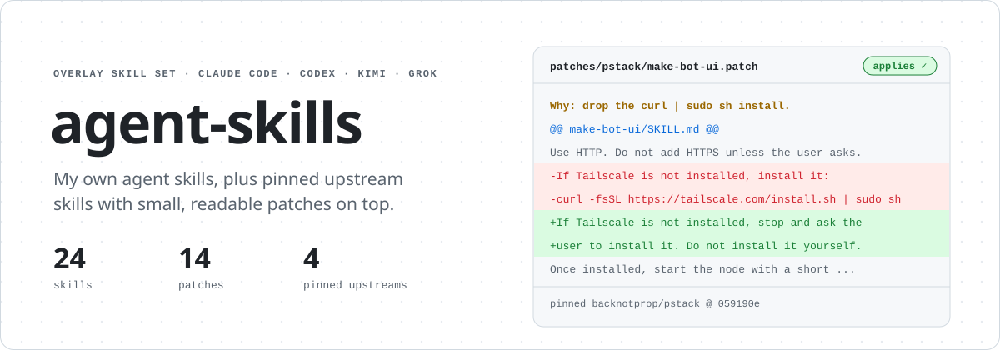
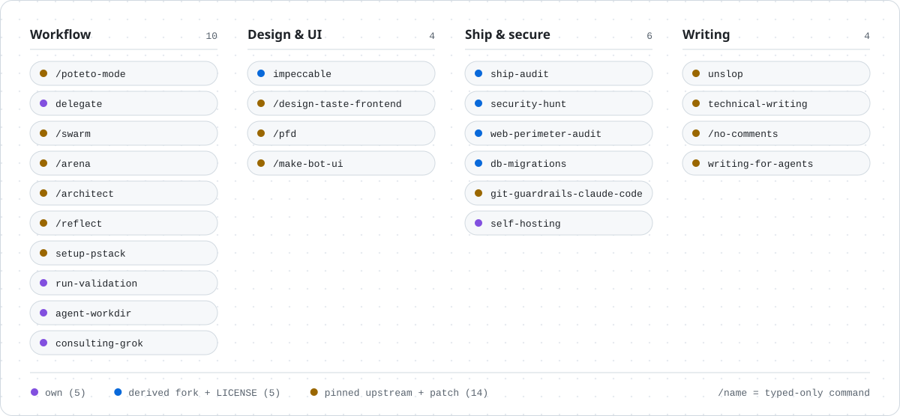

<picture>
  <source media="(prefers-color-scheme: dark)" srcset="docs/assets/hero-dark.svg">
  
</picture>

One skill set and one global instruction file shared by **Claude Code, Codex, Kimi Code and Grok**.

This repo holds three things:

- **My own skills**, written from scratch.
- **Forks** of upstream skills I changed too much to keep as patches, each with its original license.
- **Patches** on top of other people's skills, pinned to an exact commit. Each patch says why it exists.

`build.py` puts them together, shows which patches break when an upstream moves, and links the result into every CLI.

- [Why an overlay](#why-an-overlay)
- [How it works](#how-it-works)
- [Quick start](#quick-start)
- [The skills](#the-skills)
- [What I patched, and why](#what-i-patched-and-why)
- [Recommended upstream packs](#recommended-upstream-packs-not-shipped-here)
- [AGENTS.md template](#agentsmd-template)
- [Where each CLI looks](#where-each-cli-looks)
- [Working with patches](#working-with-patches)
- [Writing skills that load reliably](#writing-skills-that-load-reliably)
- [Repo layout](#repo-layout) · [Licenses](#licenses)

## Why an overlay

Most good skills come from someone else's repo. Using them as-is is rarely right:

- A pack hardcodes one vendor's model names.
- A skill runs `curl … | sudo sh`.
- A description is too long for Codex, which truncates it, so the skill never triggers.

Copying and editing works once. After that your copy drifts from upstream, and nobody can tell what you changed.

This repo keeps upstream at a pinned commit and records each change as a `.patch` you can read in a minute. Updating means moving the pin. If a patch no longer applies, the build says which one.

| Approach | Updates from upstream | Your changes visible | Effort |
|---|---|---|---|
| Install upstream as-is | yes | no changes possible | none |
| Copy and edit (detach) | manual, lossy | buried in a copy | grows over time |
| **Pin + patch (this repo)** | `bump`, broken patches listed | one `.patch` per skill with a `Why:` line | one command |

## How it works

<picture>
  <source media="(prefers-color-scheme: dark)" srcset="docs/assets/pipeline-dark.svg">
  
</picture>

1. **Pin.** [`upstreams.toml`](upstreams.toml) lists each upstream repo, a full commit sha, its license, and which folders become which skills. `license_file` copies the upstream license into every skill shipped from it.
2. **Patch.** [`patches/<upstream>/<skill>.patch`](patches) is a plain `git diff` with a `Why:` line on top. Patches apply with `git apply`, and the build stops on the first one that fails.
3. **Build.** `build.py` checks out each pin, copies the mapped paths, applies the patches, adds [`skills/`](skills), and writes `dist/`. The old `dist/` is replaced only after a fully successful build.
4. **Install.** Every skill in `dist/` is symlinked into `~/.agents/skills`, which Codex and Kimi read. Each of those is then linked into `~/.claude/skills`, which Claude Code and Grok read. One copy on disk serves all four CLIs.

`dist/` is gitignored. It includes upstream assets (one skill alone is 39 MB), so you build it locally instead of cloning it.

## Quick start

Requirements: `git` and [uv](https://docs.astral.sh/uv/). uv installs Python 3.11+ and the script's dependencies (Typer, Pydantic, Rich, tomlkit) on first run.

```sh
git clone https://github.com/mmgordon82/agent-skills && cd agent-skills
uv run build.py build      # clone pins into .cache/, apply patches, write dist/
uv run build.py install    # symlink dist/* into ~/.agents/skills and ~/.claude/skills
```

`install` never overwrites an existing skill of the same name. It prints `skip … exists` instead. To overlay this repo's patched versions on top of packs you already installed, run `uv run build.py install --force`. Rerunning `install` is safe; links that are already correct are left alone.

Grok also needs to know about the Claude directory. In `~/.grok/config.toml`:

```toml
extra_skill_dirs = ["~/.claude/skills"]
```

All commands:

| Command | What it does |
|---|---|
| `build` | Builds `dist/` from pins, patches and `skills/`. Fails without touching `dist/` if any patch doesn't apply. |
| `verify [--against DIR]` | Builds to a temp dir and diffs every skill against an installed copy (default `~/.agents/skills`). Shows exactly which files differ. |
| `diff <upstream> [--from DIR]` | Rewrites that upstream's patches from edited skills (default `dist/`). Keeps each patch's `Why:` header. |
| `bump <upstream> [sha]` | Moves the pin (default: upstream `HEAD`), lists upstream commits that touched your paths, and reports which patches still apply. |
| `install [--target] [--claude] [--force]` | Symlinks `dist/` into the skill dirs. |

## The skills

<picture>
  <source media="(prefers-color-scheme: dark)" srcset="docs/assets/skills-dark.svg">
  
</picture>

A `/` before a name means the skill is **typed-only**: it runs when you type `/name` and the model never loads it on its own. These are long skills you want on demand, and keeping them typed-only means their descriptions don't cost context in every session.

### Workflow

| Skill | Source | What it does |
|---|---|---|
| `/poteto-mode` | pstack + patch | An opinionated agent style: concise answers, deliberate subagents, simple code, verified work. Ships playbooks for features, bug fixes and multi-phase plans. |
| `delegate` | own | Multi-agent work without ceremony. Root plans and integrates; bounded explorer, worker, tester, researcher and reviewer subagents do the rest. |
| `/swarm` | pstack + patch | Fan out N parallel workers, drain them, return one report. |
| `/arena` | pstack + patch | N candidates on the same task; pick a base, graft the best parts of the losers into it. |
| `/architect` | pstack + patch | Sketch types, signatures and module structure before code, then steer implementation. |
| `/reflect` | pstack + patch | Three reviewers read the session transcript and turn learnings into edits on existing skills. |
| `setup-pstack` | pstack + patch | Map pstack roles to *your* models (top / strong / fast / panel tiers). |
| `run-validation` | own | Picks where a claim gets tested: local machine, local Docker, or a Linux amd64 VM. Never claims compatibility from a lower tier. Browser checks go through chrome-devtools MCP. |
| `agent-workdir` | own | Every report, probe, log, plan and screenshot goes to `~/agent-work/<project>/<date>-<topic>/`, never into a checkout. |
| `consulting-grok` | own | Second opinions and offloaded tasks through the Grok CLI: read-only consult and write-access delegate recipes, plus a flag reference. |

### Design & UI

| Skill | Source | What it does |
|---|---|---|
| `impeccable` | fork of pbakaus/impeccable | The lead UI workflow: build, critique, audit, polish. Adds `reference/usability.md`, about 55k characters of usability heuristics the skill reads before any UX judgment. |
| `/design-taste-frontend` | taste-skill + patch | Opinionated website builder for company, landing and product sites. Has its own finish gate. |
| `/pfd` | perception-first-design + patch | Perception-First Design analysis: analyze, evaluate, solve. |
| `/make-bot-ui` | pstack + patch | A small UI that wakes a Grok Bot over a webhook, optionally exposed on Tailscale. |

### Ship & secure

| Skill | Source | What it does |
|---|---|---|
| `ship-audit` | fork of everything-claude-code | "Is this ready to ship?" A local-evidence audit with score caps (no auth, leaked secrets, unsafe migration, no rollback, untested restore) and a short ship/block answer. Includes checks for self-hosted services. |
| `security-hunt` | fork of everything-claude-code | Review your own code for remotely reachable bugs (SSRF, auth bypass, injection, RCE, path traversal, XSS). A finding counts only if input provably reaches a sink. |
| `web-perimeter-audit` | fork of everything-claude-code | Passive curl probes against a live domain: exposed `.git`, `.env` and lockfiles, CORS reflection, cache poisoning, HSTS/CSP, cookie flags. Includes nginx and Caddy hardening snippets, tested in Docker. |
| `db-migrations` | fork of everything-claude-code | Postgres-safe migrations: lock modes, `lock_timeout`, `CREATE INDEX CONCURRENTLY`, expand-contract, batched backfills, Django and golang-migrate. |
| `git-guardrails-claude-code` | mattpocock + patch | Claude Code hooks that block destructive git commands. The patch adds a hook that blocks `--no-verify` and edits to lint, format and pre-commit configs. |
| `self-hosting` | own | Docker-first packaging defaults, plus the rules for offline or air-gapped targets: mirrors, pinned versions, vendored web assets, a public-hostname grep before shipping. |

### Writing

| Skill | Source | What it does |
|---|---|---|
| `unslop` | pstack + patch | Cuts AI tells from prose: docs, PRs, commits, UI copy. Ships `scripts/ste_lint.py`. |
| `technical-writing` | pstack + patch | READMEs, runbooks, RFCs, PR text: Diátaxis, Google style, Simplified Technical English, Global English. |
| `/no-comments` | pstack + patch | Sends the "Comment Sicko" reviewer after unnecessary comments. |
| `writing-for-agents` | mattpocock + patch | How to write skills, AGENTS.md and CLAUDE.md that agents follow. |

## What I patched, and why

Each line is the `Why:` header of the patch file it links to.

| Patch | Why |
|---|---|
| [pstack/architect](patches/pstack/architect.patch), [arena](patches/pstack/arena.patch), [poteto-mode](patches/pstack/poteto-mode.patch), [reflect](patches/pstack/reflect.patch), [swarm](patches/pstack/swarm.patch), [setup-pstack](patches/pstack/setup-pstack.patch) | Replace Cursor model slugs with generic tiers (top / strong / fast / panel) so the pack runs in any CLI. |
| [pstack/make-bot-ui](patches/pstack/make-bot-ui.patch) | Drop the `curl \| sudo sh` Tailscale install; ask the user to install it instead. |
| [pstack/no-comments](patches/pstack/no-comments.patch) | Comments are one line, two at most. |
| [pstack/technical-writing](patches/pstack/technical-writing.patch) | Let the model invoke it. Add strict mode, define terms, never drop caveats, and grounding and table rules, merged from Simplified Technical English and plain-writing skills. |
| [pstack/unslop](patches/pstack/unslop.patch) | Let the model invoke it, put trigger words first in the description, and add rules 34–41, a "How to apply" section and a Simplified Technical English lint script, merged from three anti-slop skills. |
| [taste-skill/design-taste-frontend](patches/taste-skill/design-taste-frontend.patch) | Typed-only in Claude **and** Codex, with a short description. |
| [pfd/pfd](patches/pfd/pfd.patch) | Typed-only `/pfd`; flattened layout; version history cut. |
| [mattpocock/writing-for-agents](patches/mattpocock/writing-for-agents.patch) | Shorter description with trigger words first. |
| [mattpocock/git-guardrails-claude-code](patches/mattpocock/git-guardrails-claude-code.patch) | Add `block-weakened-checks.sh`: the agent fixes the code instead of skipping hooks or loosening linters. |

Two upstreams became forks because their diffs would have been the whole skill:

- **impeccable** ([CHANGES.md](skills/impeccable/CHANGES.md)) is a trimmed fork. It adds `usability.md`, a no-fake-data rule, mobile viewport rules, and online-by-default assets.
- **everything-claude-code**: four skills rewritten for self-hosted Python/Go work, each with an `Adapted from … @3f14a10` line and the MIT license.

## Recommended upstream packs (not shipped here)

Skills I use unmodified. Install them from their source so you get their updates:

| Pack | What you get | Install |
|---|---|---|
| [backnotprop/pstack](https://github.com/backnotprop/pstack) | The rest of pstack: 58 principle and workflow skills. `/poteto-mode` refers to them, so install the full pack, then overlay this repo's patched versions with `install --force`. | clone, then copy `skills/*` into `~/.agents/skills` |
| [emilkowalski/skills](https://github.com/emilkowalski/skills) | 20 animation and design-engineering skills: `animate`, `choreograph`, `gestures`, `review-animations`, `apple-design`, `mobile-native`… | `npx skills add emilkowalski/skills -g` |
| [mattpocock/skills](https://github.com/mattpocock/skills) | Engineering workflow: `codebase-design`, `diagnosing-bugs`, `domain-modeling`, `grilling`, `to-spec`, `wizard`, plus typed-only long-form writing (`writing-fragments` → `writing-beats` / `writing-shape`). | `npx skills add mattpocock/skills -g` |
| [nextlevelbuilder/ui-ux-pro-max-skill](https://github.com/nextlevelbuilder/ui-ux-pro-max-skill) | Local design research database that `impeccable` consults. | `npx skills add nextlevelbuilder/ui-ux-pro-max-skill -g` |
| [dzhng/jevgrep](https://github.com/dzhng/jevgrep) | Answers "how does X work in this repo" with ranked excerpts before grep. | `npx skills add dzhng/jevgrep -g` |
| [obra/superpowers](https://github.com/obra/superpowers) | `brainstorming` (I also run the full plugin in Claude Code). | `npx skills add obra/superpowers -g` |
| [rea-agents](https://www.npmjs.com/package/rea-agents) | Reverse Engineer Anything: MCP server and skill for binaries, apps, firmware and web bundles. It manages its own skill copy. | `npm i -g rea-agents && rea setup` |

The skills CLI may write real copies into `~/.claude/skills`. To keep one source, move them to `~/.agents/skills` and symlink them back.

## AGENTS.md template

[`AGENTS.template.md`](AGENTS.template.md) is my global instruction file with personal details replaced by placeholders. It is short on purpose (about 7.4k characters; Grok's cap is 10k). Detailed procedures live in skills that the file points to by path:

| Section | Holds | Details in |
|---|---|---|
| How to talk to me | Answer first, less by default, labeled options, push back | — |
| Match effort | Small: just do it. Big: spec → approval → plan. | — |
| Engineering taste | Simplicity > maintainability > correctness > performance; parse at boundaries; rerunnable ops; behavior tests | — |
| Languages & dependencies | Python → Go → Bash → JS; use good libraries; uv + PEP 723 | — |
| Self-hosting | Online by default; offline only when stated | `self-hosting` |
| Behavior I expect | Verify against the real output; test the assumption after two failed fixes; encode repeated corrections as checks | — |
| Where to run validation | Pick the first environment that has every property the claim depends on | `run-validation` |
| Agent work dir | Output never goes into a checkout | `agent-workdir` |
| Building sites, UIs & content | `impeccable` + `usability.md`; no unrequested copy; labs keep their difficulty | `impeccable` |

Use one file for every CLI:

```sh
cp AGENTS.template.md ~/.agents/AGENTS.md            # then fill in the <PLACEHOLDERS>
ln -sf ~/.agents/AGENTS.md ~/.claude/CLAUDE.md
ln -sf ~/.agents/AGENTS.md ~/.codex/AGENTS.md
ln -sf ~/.agents/AGENTS.md ~/.grok/AGENTS.md
```

Machine-specific commands (VM CLIs, MCP wrapper scripts) belong in a private `local-tooling` skill that you don't publish. `run-validation` reads it by path when it exists.

## Where each CLI looks

| CLI | Skills | Global instructions | Notes |
|---|---|---|---|
| Claude Code | `~/.claude/skills`, plugins | `~/.claude/CLAUDE.md` | `disable-model-invocation: true` makes a skill typed-only. |
| Codex | `~/.agents/skills`, `~/.codex/skills`, plugins | `~/.codex/AGENTS.md` | Truncates descriptions to about 80 characters. Typed-only needs `agents/openai.yaml` with `policy: allow_implicit_invocation: false`. |
| Kimi Code | `~/.agents/skills`, `~/.kimi-code/skills`, `~/.claude/skills`, `~/.codex/skills` | `~/.agents/AGENTS.md` | Reads all four trees; the symlinks resolve to the same copy. |
| Grok | `~/.grok/skills`, plus `extra_skill_dirs` | `~/.grok/AGENTS.md` | Global instructions are capped at 10k characters. |

## Working with patches

**Change a patched skill:**

```sh
uv run build.py build
$EDITOR dist/unslop/SKILL.md             # edit the built copy
uv run build.py diff pstack              # writes patches/pstack/unslop.patch, keeps its Why: line
uv run build.py build && git add patches && git commit
```

To capture edits you made in your installed skills, run `diff pstack --from ~/.agents/skills`.

**Patch a new upstream skill:** add it to that upstream's `paths` in `upstreams.toml`, build, edit `dist/<skill>`, then run `diff`. Add a `Why:` line at the top of the new patch.

**Update an upstream:**

```sh
uv run build.py bump pstack              # moves the pin to upstream HEAD
# backnotprop/pstack: 059190e → 0d2dc00, 2 commits touch our paths
# pstack  arena.patch   error: patch failed: arena/SKILL.md:14
```

Fix each failing patch by hand-applying it in `dist/` and running `diff`, or revert `upstreams.toml`. `bump` never touches `dist/`.

**Check nothing drifted:** `uv run build.py verify` builds to a temp dir and compares every skill with `~/.agents/skills`, byte for byte.

## Writing skills that load reliably

Lessons from running one skill set across four CLIs:

- **Trigger words first.** Codex shows about 80 characters of a description. Start with "Use when …" and the words a user would actually say.
- **Name the path in AGENTS.md.** A one-line rule plus the explicit `SKILL.md` path loads far more reliably than a good description alone: "Before running tests… read the `run-validation` skill (`~/.agents/skills/run-validation/SKILL.md`)."
- **Put the must-read line at the top of the skill.** A reference file the agent has to read, such as `usability.md`, gets a bold line at the top of `SKILL.md`. Mentioning it in passing is not enough.
- **Make long skills typed-only.** They cost no context until you call them. Set it for both Claude (`disable-model-invocation`) and Codex (`agents/openai.yaml`).
- **One source on disk.** `~/.agents/skills` holds the real copies; everything else links to it. Duplicate copies drift.

## Repo layout

```
AGENTS.template.md     global instructions, placeholders for personal parts
upstreams.toml         pins: repo, sha, license, paths
patches/<upstream>/    one .patch per skill, each with a Why: header
skills/                own skills, plus forks that carry their own LICENSE
build.py               build · verify · diff · bump · install (uv script)
docs/graphics.py       renders docs/assets/*.svg from the repo data
```

`docs/graphics.py` reads `upstreams.toml`, `skills/` and `dist/`, so the counts and the skill map stay accurate. Run `uv run docs/graphics.py` after adding a skill. It fails if a skill isn't placed in a group.

## Licenses

| Content | License |
|---|---|
| Own skills, `build.py`, docs, template | [MIT](LICENSE) |
| pstack, taste-skill and mattpocock skills, plus patches to them | MIT; each built skill carries its upstream `LICENSE` |
| `pfd` and its patch | CC BY-SA 4.0 (share-alike applies to the adaptation) |
| `impeccable` | Apache-2.0: `LICENSE`, `NOTICE.md` and `CHANGES.md` in the skill |
| `ship-audit`, `security-hunt`, `web-perimeter-audit`, `db-migrations` | MIT, adapted from affaan-m/everything-claude-code @3f14a10 |
