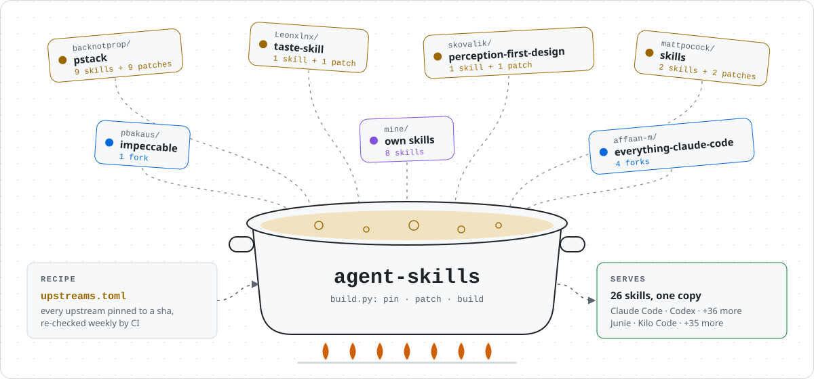

<picture>
  <source media="(prefers-color-scheme: dark)" srcset="docs/assets/hero-dark.svg">
  
</picture>

My skill set for coding agents. Three things set it apart:

- **Cross-agent.** One copy of every skill on disk and one global `AGENTS.md`, read by **<!-- agents:list -->Claude Code, Codex, Grok, Kimi Code and Pi<!-- /agents:list -->**, and installable into any other agent npx skills supports ([details](#where-each-agent-looks)). Every agent works from the same directories, the same structure and the same rules.
- **Token-lean.** Every model-invocable skill puts its description into every session before you type a word. Building this set, I cut 174 skills: about 11k tokens of skill listings that loaded at every session start. Long skills I call by name are now typed-only, and the shared `AGENTS.md` went from 10–11.5k characters per CLI to under 8k. [`skill-critique`](skills/skill-critique/SKILL.md) measures this for your own setup and reviews every skill on the machine.
- **Opinionated.** It is built for me and tailored to how I work. Take what fits. Every change to someone else's skill is a small patch with a `Why:` line, so you can see each opinion and drop the ones you don't share.

- [What's cooking](#whats-cooking)
- [How it works](#how-it-works)
- [Quick start](#quick-start)
- [The skills](#the-skills)
- [What I patched, and why](#what-i-patched-and-why)
- [Customize](#customize)
- [Releases](#releases)
- [Recommended upstream packs](#recommended-upstream-packs-not-shipped-here)
- [AGENTS.md template](#agentsmd-template)
- [Where each agent looks](#where-each-agent-looks)
- [Working with patches](#working-with-patches)
- [Writing skills that load reliably](#writing-skills-that-load-reliably)
- [Repo layout](#repo-layout) · [Licenses](#licenses)

## What's cooking

<picture>
  <source media="(prefers-color-scheme: dark)" srcset="docs/assets/pot-dark.svg">
  
</picture>

Most good skills come from someone else's repo, and using them as-is is rarely right:

- A pack hardcodes one vendor's model names.
- A skill runs `curl … | sudo sh`.
- A description is too long for Codex, which truncates it, so the skill never triggers.
- A rarely used skill costs hundreds of tokens in every session.

Copying and editing works once. After that your copy drifts from upstream, and nobody can tell what you changed. This repo keeps each upstream at a pinned commit and records every change as a `.patch` you can read in a minute. A weekly CI job moves the pins, re-applies the patches and publishes a release when the result changes.

| Approach | Updates from upstream | Your changes visible | Effort |
|---|---|---|---|
| Install upstream as-is | yes | no changes possible | none |
| Copy and edit (detach) | manual, lossy | buried in a copy | grows over time |
| **Pin + patch (this repo)** | weekly CI, broken patches flagged | one `.patch` per skill with a `Why:` line | none until a patch breaks |

## How it works

<picture>
  <source media="(prefers-color-scheme: dark)" srcset="docs/assets/pipeline-dark.svg">
  
</picture>

1. **Pin.** [`upstreams.toml`](upstreams.toml) lists each upstream repo, a full commit sha, its license, and which folders become which skills. `license_file` copies the upstream license into every skill shipped from it.
2. **Patch.** [`patches/<upstream>/<skill>.patch`](patches) is a plain `git diff` with a `Why:` line on top. Patches apply with `git apply`, and the build stops on the first one that fails.
3. **Build.** `build.py` checks out each pin, copies the mapped paths, applies the patches, adds [`skills/`](skills), and writes `dist/`. The old `dist/` is replaced only after a fully successful build.
4. **Install.** [npx skills](https://github.com/vercel-labs/skills) puts one copy of each skill in `~/.agents/skills` and links it into the skills dir of every agent you pick. When you build from source, `build.py install` points those copies at `dist/`, so each rebuild is live in every agent.

`dist/` is gitignored. It includes upstream assets (one skill alone is 39 MB), so you build it locally or download a [release](#releases).

## Quick start

**With [`npx skills`](https://github.com/vercel-labs/skills)** (installs the built release set from the `release` branch):

```sh
npx skills add mmgordon82/agent-skills#release -g --skill '*' -y    # rerun weekly to get new skills too
npx skills add mmgordon82/agent-skills#20261119 -g --skill '*' -y   # or pin one release
```

Use `#`, not `@`: `@20261119` is read as a skill name. `npx skills update -g` refreshes skills you already have but never adds new ones, so rerun `add` to pick those up. While the repo is private, this works only for accounts with access (it clones with your git or `gh` login).

**From a release archive:**

```sh
mkdir -p ~/.agents/skills
gh release download --repo mmgordon82/agent-skills -p '*.tar.gz' -O - | tar xz -C ~/.agents/skills
```

Or download the `.tar.gz` or `.zip` from the [releases page](https://github.com/mmgordon82/agent-skills/releases) and extract it into your skills directory. Skills with the same name are replaced. Agents that don't read `~/.agents/skills` need a link per skill in their own dir ([which ones](#where-each-agent-looks)); `npx skills` does that for you.

**From source** (requires `git` and [uv](https://docs.astral.sh/uv/); uv installs Python 3.11+ and the script's dependencies on first run):

```sh
git clone https://github.com/mmgordon82/agent-skills && cd agent-skills
uv run build.py build                     # clone pins into .cache/, apply patches, write dist/
npx skills add ./dist -g --skill '*' -y   # once: copy into ~/.agents/skills, link the agents you use
uv run build.py install --force           # point ~/.agents/skills/<skill> at dist/: rebuilds go live
```

`npx skills` handles agents: it detects them, links each skill into their skills dirs and keeps a lock file. `build.py install` only replaces the copies in `~/.agents/skills` with links into `dist/`, so `build.py build` updates every agent at once, and creates the settings file. Without `--force` it skips skills that already exist. Rerunning it is safe.

All commands:

| Command | What it does |
|---|---|
| `build` | Builds `dist/` from pins, patches and `skills/`. Fails without touching `dist/` if any patch doesn't apply. |
| `verify [--against DIR]` | Builds to a temp dir and diffs every skill against an installed copy (default `~/.agents/skills`). Shows exactly which files differ; missing or changed skills exit 1. |
| `diff <upstream> [--from DIR]` | Rewrites that upstream's patches from edited skills (default `dist/`). Keeps each patch's `Why:` header. |
| `bump [UPSTREAM…] [--rev SHA]` | Moves pins to upstream `HEAD` (default: all). A pin moves only if all its patches still apply; otherwise it stays, and the command exits 1. |
| `workspace <upstream> <dir>` | Starts rebuilding broken patches: lays out the upstream at its pin as a git repo, applies its patches (3-way where they conflict) and lists which to rewrite from their Why. |
| `install [--target] [--force]` | Points every `~/.agents/skills/<skill>` at `dist/<skill>` (live development; agents link there via npx skills). Creates the settings file if missing. |

## The skills

<picture>
  <source media="(prefers-color-scheme: dark)" srcset="docs/assets/skills-dark.svg">
  
</picture>

A `/` before a name means the skill is **typed-only**: it runs when you type `/name` and the model never loads it on its own. These are long skills you want on demand, and keeping them typed-only means their descriptions don't cost context in every session.

### Workflow

| Skill | Source | What it does |
|---|---|---|
| `/poteto-mode` | pstack + patch | An opinionated agent style: concise answers, deliberate subagents, simple code, verified work. Ships playbooks for features, bug fixes and multi-phase plans. |
| `delegate` | own | Multi-agent work without ceremony. Root plans and integrates; bounded explorer, worker, tester, researcher and reviewer subagents do the rest. |
| `/swarm` | pstack + patch | Fan out N parallel workers, drain them, return one report. |
| `/arena` | pstack + patch | N candidates on the same task; pick a base, graft the best parts of the losers into it. |
| `/architect` | pstack | Sketch types, signatures and module structure before code, then steer implementation. |
| `/reflect` | pstack | Reads the session transcript for lasting lessons and turns each into an edit on an existing skill. |
| `setup-pstack` | pstack + patch | Map pstack roles to *your* models through tiers (strong / fast / panel). |
| `adversarial-review` | own | Runs a different agent CLI (Claude, Codex, Grok, Kimi, Pi or any other) headless and read-only to attack your work: bugs, holes, unproven claims, cases you didn't expect. You verify each finding before acting. |

### Agent setup

| Skill | Source | What it does |
|---|---|---|
| `run-validation` | own | Picks where a claim gets tested: this machine, local Docker, or a VM matching the deploy target. Knows when CPU architecture matters (native code, binaries, images) and when it doesn't. Browser checks via chrome-devtools or Playwright MCP. |
| `agent-workdir` | own | Every report, probe, log, plan and screenshot goes to `<root>/<project>/<date>-<topic>/`, never into a checkout. `<root>` is [configurable](#customize), default `~/agent-work`. |
| `/handoff` | own | Writes a handoff so a fresh agent can continue from the same spot: goal and stated constraints, what was tried, what changed and why, current state, next steps. Saved to `<root>/<project>/handoffs/<YYYY-MM-DD>-<name>.md` ([configurable](#customize)). |
| `/skill-critique` | own | Reviews every skill on the machine: an overview by category with auto-load cost per agent, collisions, duplicates and near-duplicates; the per-session load of each agent (skills, plugins, hooks, instructions); then cuts, dedupes and one shared layout, applied after approval. Ships `scripts/skill_scan.py`. |

### Design & UI

| Skill | Source | What it does |
|---|---|---|
| `impeccable` | fork of pbakaus/impeccable | The lead UI workflow: build, critique, audit, polish. Adds `reference/usability.md`, about 55k characters of usability heuristics the skill reads before any UX judgment. |
| `/design-taste-frontend` | taste-skill + patch | Opinionated website builder for company, landing and product sites. Has its own finish gate. |
| `/pfd` | perception-first-design + patch | Perception-First Design analysis: analyze, evaluate, solve. |

### Ship & secure

| Skill | Source | What it does |
|---|---|---|
| `ship-audit` | fork of everything-claude-code | "Is this ready to ship?" A local-evidence audit with score caps (no auth, leaked secrets, unsafe migration, no rollback, untested restore) and a short ship/block answer. Includes checks for self-hosted services. |
| `security-hunt` | fork of everything-claude-code | Review your own code for remotely reachable bugs (SSRF, auth bypass, injection, RCE, path traversal, XSS). A finding counts only if input provably reaches a sink. |
| `web-perimeter-audit` | fork of everything-claude-code | Passive curl probes against a live domain: exposed `.git`, `.env` and lockfiles, CORS reflection, cache poisoning, HSTS/CSP, cookie flags. Includes nginx and Caddy hardening snippets, tested in Docker. |
| `db-migrations` | fork of everything-claude-code | Postgres-safe migrations: lock modes, `lock_timeout`, `CREATE INDEX CONCURRENTLY`, expand-contract, batched backfills, Django and golang-migrate. |
| `git-guardrails-claude-code` | mattpocock + patch | Claude Code hooks that block destructive git commands. The patch adds a hook that blocks `--no-verify` and edits to lint, format and pre-commit configs. |
| `docker-packaging` | own | Docker-first packaging: one small dockerizable app, existing pinned images over new Dockerfiles, Docker only where it validates something. |
| `airgap` | own | Only for targets you call offline. Build it: internal mirrors (optionally from [settings](#customize)), sensible version pins, no public fetches, vendored assets. Prove it: isolated runs (`--network none`, Linux netns), a network probe, a browser request audit, Playwright offline and native-error recipes, a public-host scan. |

### Writing

| Skill | Source | What it does |
|---|---|---|
| `unslop` | pstack + patch | Cuts AI tells from prose: docs, PRs, commits, UI copy. Ships `scripts/ste_lint.py`. |
| `technical-writing` | pstack + patch | READMEs, runbooks, RFCs, PR text: Diátaxis, Google style, Simplified Technical English, Global English. |
| `/no-comments` | pstack + patch | Sends the "Comment Sicko" reviewer after unnecessary comments. |
| `writing-for-agents` | mattpocock + patch | How to write skills, AGENTS.md and CLAUDE.md that agents follow. |

## What I patched, and why

Each line is the first line of the patch's `Why:` header. Below it, every header explains the problem, what the patch changes, what to keep when rebasing, and how to rebuild it on a new upstream version, so a broken patch can be rewritten from intent ([how](#when-an-upstream-breaks-patches)).

| Patch | Why |
|---|---|
| [mattpocock/git-guardrails-claude-code](patches/mattpocock/git-guardrails-claude-code.patch) | Add block-weakened-checks.sh: block --no-verify and edits to lint, format and pre-commit configs. |
| [mattpocock/writing-for-agents](patches/mattpocock/writing-for-agents.patch) | A trigger-first description. |
| [pfd/pfd](patches/pfd/pfd.patch) | Typed-only /pfd, paths fixed for the flattened layout, version history cut, Codex typed-only. |
| [pstack/arena](patches/pstack/arena.patch) | Use the panel tier for runners and the judge pool, and model-agnostic fallbacks, instead of Cursor model ids. |
| [pstack/no-comments](patches/pstack/no-comments.patch) | Comments that survive are one line, two at most. |
| [pstack/poteto-mode](patches/pstack/poteto-mode.patch) | Define the model tiers (strong, fast, panel) in the Subagents section; playbooks use them instead of Cursor model ids. |
| [pstack/setup-pstack](patches/pstack/setup-pstack.patch) | Configure tiers (strong, fast, panel) mapped to the models a harness has, instead of writing Cursor model ids. |
| [pstack/swarm](patches/pstack/swarm.patch) | Use the fast tier for workers, and a model-agnostic fallback, instead of a Cursor model id. |
| [pstack/technical-writing](patches/pstack/technical-writing.patch) | Let the model invoke it, with a trigger-first description, and add four rules from the deleted STE and plain-writing skills. |
| [pstack/unslop](patches/pstack/unslop.patch) | Let the model invoke it, with a trigger-first description; add rules 34-41 and "How to apply" from three deleted anti-slop skills, plus an STE lint script. |
| [taste-skill/design-taste-frontend](patches/taste-skill/design-taste-frontend.patch) | Typed-only /design-taste-frontend with a one-line description, in Claude and in Codex. |

Two upstreams became forks because their diffs would have been the whole skill:

- **impeccable** ([CHANGES.md](skills/impeccable/CHANGES.md)) is a trimmed fork. It adds `usability.md`, a no-fake-data rule, mobile viewport rules, and online-by-default assets.
- **everything-claude-code**: four skills rewritten for self-hosted Python/Go work, each with an `Adapted from … @3f14a10` line and the MIT license.

## Customize

Skills read one settings file, the same for every agent: `${XDG_CONFIG_HOME:-~/.config}/agent-skills/settings.toml`. `build.py install` creates it from [`settings.example.toml`](settings.example.toml) if it doesn't exist and never overwrites it. Installed another way (`npx skills`, a release archive)? Create it yourself:

```sh
mkdir -p ~/.config/agent-skills && $EDITOR ~/.config/agent-skills/settings.toml
```

with this content, then change what you need:

```toml
# agent-skills settings: ${XDG_CONFIG_HOME:-~/.config}/agent-skills/settings.toml
# Every key is optional. A missing file or key means the default shown here.

[workdir]
# Where agents put reports, probes, logs, plans and handoffs: <root>/<project>/<YYYY-MM-DD>-<topic>/.
# Absolute or ~-prefixed. Never inside a repo checkout.
root = "~/agent-work"

[handoff]
# Folder for /handoff documents, relative to <root>/<project>/.
dir = "handoffs"

[review]
# adversarial-review picks the first installed CLI in this list that isn't the one running.
reviewers = ["codex", "grok", "claude", "kimi", "pi"]

[offline]
# Optional. Internal mirrors for the airgap skill, used only when you say a target is
# offline. Leave them empty if you don't need them: agents then work as they normally would.
apt_mirror = ""           # e.g. "https://artifactory.example.com/artifactory/debian-remote"
pypi_index = ""           # e.g. "https://artifactory.example.com/artifactory/api/pypi/pypi-remote/simple"
npm_registry = ""         # e.g. "https://artifactory.example.com/artifactory/api/npm/npm-remote/"
go_proxy = ""             # e.g. "https://artifactory.example.com/artifactory/api/go/go-remote"
container_registry = ""   # e.g. "artifactory.example.com/docker-remote"

[validation]
# The platform you usually deploy to: "linux/amd64" or "linux/arm64". A project's AGENTS.md overrides it.
# Architecture-dependent claims (native code, binaries, images) need an environment with this arch.
target = "linux/amd64"
# Browser-check tool: "chrome-devtools", "playwright", or "none".
browser = "chrome-devtools"
# Name of a private skill with machine-specific commands (VM CLI, MCP wrapper paths).
# run-validation reads it when it needs a VM. Leave as is if you don't have one.
local_tooling = "local-tooling"

# Coding agents, for /skill-critique and the docs. The shipped ones are in
# skills/skill-critique/agents.toml; add yours here, or override a shipped one field by field (same id).
# Required: label, home, skills. Optional: check_binary (programs on PATH), check_dir (more dirs that
# must exist), check_boolean_operator ("AND", the default: home and every check; "OR": any one).
#
# [agents.my-cli]
# label = "My CLI"
# home = "~/.my-cli"
# skills = "~/.agents/skills"
# check_binary = ["my-cli"]
```

| Key | Used by |
|---|---|
| `workdir.root` | `agent-workdir`, `handoff`, `adversarial-review`, `skill-critique`, and the AGENTS.md template |
| `handoff.dir` | `handoff` |
| `review.reviewers` | `adversarial-review` |
| `offline.*` | `airgap`, optional: used only when set and the target is offline |
| `agents.<id>` | Your own agents, or overrides of shipped ones, for `/skill-critique` and [Where each agent looks](#where-each-agent-looks) |
| `validation.*` | `run-validation`: deploy target arch, browser tool, private VM-tooling skill |

- **No file, or a key missing:** the agent uses the default shown above without asking. A fresh install behaves exactly like the defaults.
- **Broken file or bad value** (invalid TOML, wrong type, a relative or in-repo `root`): the agent uses the default for that task and tells you which key to fix. It never writes output into the repo instead.
- **`root` missing on disk:** the agent creates it. If it can't, it stops and asks.

**Your own skills can use it too.** The file isn't reserved for this repo's skills. Give each of your skills its own section, named after the skill so keys never clash, and put private values there (hostnames, tool paths, account names) instead of in the skill. Skills here ignore sections they don't know, and `install` never overwrites the file. Add a section:

```toml
[my-skill]
api_base = "https://internal.example.com"
```

and paste this into your skill's `SKILL.md`:

```markdown
**Settings:** read `[my-skill]` from `${XDG_CONFIG_HOME:-$HOME/.config}/agent-skills/settings.toml`.
No file or no key → use the defaults below. A broken value → use the default and tell the user which key to fix.
```

## Releases

[`.github/workflows/release.yml`](.github/workflows/release.yml) runs every Monday and on manual dispatch (**Actions → release → Run workflow**):

1. `build.py bump` moves every pin to its upstream `HEAD`. If any upstream's patches no longer apply, the job fails right here: nothing is built or released until the patches are rebuilt ([how](#when-an-upstream-breaks-patches)).
2. `build.py build` writes `dist/`.
3. [`ci/release.py`](ci/release.py) compares `dist/` with the last published release, as git trees (file contents and modes). If nothing changed (for example, an upstream commit only touched its CI config), it stops. No release.
4. Otherwise it commits the moved pins to `main`, then commits `dist/` as one new commit on the **`release` branch**: the skill folders at the root, nothing else, with a `Source: <main sha>` trailer. So `git diff 20261119 20261126` (or GitHub's compare view) shows exactly what changed for users between two releases, and `npx skills add …#release` installs it.
5. It tags that commit with the date (`20261119`; a second release that day is `20261119.2`) and publishes a GitHub release with `agent-skills-<version>.tar.gz` and `.zip`. Each archive holds the skill folders, ready to extract into a skills directory.
6. The release notes are a bullet-point changelog that OpenAI `gpt-6.1-terra` writes from the diff between the two release commits, the upstream commit logs and this repo's commits. If generation fails, the release still publishes with fallback notes, then the job exits 1 to alert you. The prompt and model are in `ci/release.py`.

Setup: add an `OPENAI_API_KEY` repository secret. To preview a release locally: `OPENAI_API_KEY=… uv run ci/release.py --dry-run`. A run that pushed the branch but failed to publish finishes the same release on the next run.

## Recommended upstream packs (not shipped here)

Skills I use unmodified. Install them from their source so you get their updates:

| Pack | What you get | Install |
|---|---|---|
| [backnotprop/pstack](https://github.com/backnotprop/pstack) | The rest of pstack: 58 principle and workflow skills. `/poteto-mode` refers to them, so install the full pack first, then this repo's set, so its patched versions replace pstack's. | `npx skills add backnotprop/pstack -g --skill '*'` |
| [emilkowalski/skills](https://github.com/emilkowalski/skills) | 20 animation and design-engineering skills: `animate`, `choreograph`, `gestures`, `review-animations`, `apple-design`, `mobile-native`… | `npx skills add emilkowalski/skills -g` |
| [mattpocock/skills](https://github.com/mattpocock/skills) | Engineering workflow: `codebase-design`, `diagnosing-bugs`, `domain-modeling`, `grilling`, `to-spec`, `wizard`, plus typed-only long-form writing (`writing-fragments` → `writing-beats` / `writing-shape`). Its `handoff` has the same name as this repo's; add this repo's set after it to keep mine. | `npx skills add mattpocock/skills -g` |
| [nextlevelbuilder/ui-ux-pro-max-skill](https://github.com/nextlevelbuilder/ui-ux-pro-max-skill) | Local design research database that `impeccable` consults. | `npx skills add nextlevelbuilder/ui-ux-pro-max-skill -g` |
| [dzhng/jevgrep](https://github.com/dzhng/jevgrep) | Answers "how does X work in this repo" with ranked excerpts before grep. | `npx skills add dzhng/jevgrep -g` |
| [obra/superpowers](https://github.com/obra/superpowers) | `brainstorming` (I also run the full plugin in Claude Code). | `npx skills add obra/superpowers -g` |
| [rea-agents](https://www.npmjs.com/package/rea-agents) | Reverse Engineer Anything: MCP server and skill for binaries, apps, firmware and web bundles. It manages its own skill copy. | `npm i -g rea-agents && rea setup` |

The skills CLI may write real copies into `~/.claude/skills`. To keep one source, move them to `~/.agents/skills` and symlink them back. `/skill-critique` finds these copies for you.

## AGENTS.md template

[`AGENTS.template.md`](AGENTS.template.md) is my global instruction file with personal details replaced by placeholders. It is short on purpose (about 7.5k characters; Grok's cap is 10k). Detailed procedures live in skills that the file points to by path:

| Section | Holds | Details in |
|---|---|---|
| How to talk to me | Answer first, less by default, labeled options, push back | — |
| Match effort | Small: just do it. Big: spec → approval → plan. | — |
| Engineering taste | Simplicity > maintainability > correctness > performance; parse at boundaries; rerunnable ops; behavior tests | — |
| Languages & dependencies | Python → Go → Bash → JS; use good libraries; uv + PEP 723 | — |
| Self-hosting | Online by default; offline only when stated | `docker-packaging`, `airgap` |
| Behavior I expect | Verify against the real output; test the assumption after two failed fixes; encode repeated corrections as checks | — |
| Where to run validation | Pick the first environment that has every property the claim depends on | `run-validation` |
| Agent work dir | Output never goes into a checkout | `agent-workdir` |
| Building sites, UIs & content | `impeccable` + `usability.md`; no unrequested copy; labs keep their difficulty | `impeccable` |

Use one file for every CLI:

```sh
cp AGENTS.template.md ~/.agents/AGENTS.md            # then fill in the <PLACEHOLDERS>
ln -sf ~/.agents/AGENTS.md ~/.claude/CLAUDE.md
ln -sf ~/.agents/AGENTS.md ~/.codex/AGENTS.md
ln -sf ~/.agents/AGENTS.md ~/.grok/AGENTS.md
mkdir -p ~/.pi/agent && ln -sf ~/.agents/AGENTS.md ~/.pi/agent/AGENTS.md
```

Kimi Code reads `~/.agents/AGENTS.md` directly. Machine-specific commands (VM CLIs, MCP wrapper scripts) belong in a private `local-tooling` skill that you don't publish. `run-validation` reads it by path when it exists.

## Where each agent looks

Agents come from one registry, [`skills/skill-critique/agents.toml`](skills/skill-critique/agents.toml): a label, a home dir, the dir it reads skills from, and optional detection checks. The agents below are `verified`: their layout and quirks were checked by hand, and `/skill-critique` measures them exactly. The registry also carries the agent table of [npx skills](https://github.com/vercel-labs/skills), with the same ids, so the scan can detect any of those agents (even ones with no skills) and measure them with generic rules. Installing is npx skills' job; the registry only describes agents. Add your own without touching the repo: see [Customize](#customize). Refresh the npx part with `uv run tools/npx_agents.py <unpacked skills package>`.

<!-- agents:table -->
| Agent | Id | Detected when | Reads skills from |
|---|---|---|---|
| Claude Code | `claude-code` | `~/.claude` exists | `~/.claude/skills` |
| Codex | `codex` | `~/.codex` exists | `~/.agents/skills` |
| Grok | `grok` | `~/.grok` exists, and `grok` on PATH | `~/.grok/skills` |
| Kimi Code | `kimi-code-cli` | `~/.kimi-code` exists, and `kimi` on PATH | `~/.agents/skills` |
| Pi | `pi` | `~/.pi/agent` exists, and `pi` on PATH | `~/.agents/skills` |
<!-- /agents:table -->

Known differences between them (handled in `/skill-critique`'s scan):

- **Claude Code:** typed-only via `disable-model-invocation: true`, or `skillOverrides` in `settings.json`. Tolerates invalid YAML frontmatter. Global instructions: `~/.claude/CLAUDE.md`.
- **Codex:** also reads `~/.codex/skills` and plugins. Shows about 80 characters of a description. Typed-only needs `agents/openai.yaml` with `policy: allow_implicit_invocation: false`. Skips skills with invalid YAML frontmatter.
- **Grok:** also reads `~/.claude/skills` and `[skills] paths` (Grok 1.0.77); `[paths] extra_skill_dirs` does not add skills. Global instructions are capped at 10k characters.
- **Kimi Code:** also reads `~/.kimi-code/skills` and `extra_skill_dirs` in its `config.toml`. Global instructions: `~/.agents/AGENTS.md`.
- **Pi:** global instructions in `~/.pi/agent/AGENTS.md`; set `PI_CODING_AGENT_DIR` to move it.

## Working with patches

**Change a patched skill:**

```sh
uv run build.py build
$EDITOR dist/unslop/SKILL.md             # edit the built copy
uv run build.py diff pstack              # writes patches/pstack/unslop.patch, keeps its Why: line
uv run build.py build && git add patches && git commit
```

To capture edits you made in your installed skills, run `diff pstack --from ~/.agents/skills`.

**Patch a new upstream skill:** add it to that upstream's `paths` in `upstreams.toml`, build, edit `dist/<skill>`, then run `diff`. Add a `Why:` line at the top of the new patch.

### When an upstream breaks patches

An upstream release can rewrite the lines a patch touches. pstack 0.15.43 did: it rewrote the same paragraphs, renamed the model ids our patches replace, and deleted two skills' model choices outright. The weekly job then fails at the bump step and releases nothing. Rebuild the patches from their intent, not by forcing the old diff on:

```sh
uv run build.py bump pstack                       # shows the new commit and which patches fail
# set pstack's rev in upstreams.toml to the new commit, then:
uv run build.py workspace pstack ~/tmp/pstack-ws  # new upstream as a git repo, patches applied where they can be
```

`workspace` prints one line per patch: applies, merged (check it), or rewrite from its Why, with conflicts marked. For each patch to rewrite, read its header and redo the change on the new upstream text: keep what upstream added, restate it in the patch's terms, and drop parts upstream made unnecessary. `git -C ~/tmp/pstack-ws diff HEAD` shows your edits against plain upstream. Then:

```sh
uv run build.py diff pstack --from ~/tmp/pstack-ws   # rewrites the patches, keeps each header
uv run build.py build && uv run tests/run.py
```

`diff` deletes a patch that has nothing left to change. Update a header when its reasoning changed, so the next rebuild starts from the right intent.

`build` always starts from a clean copy of each upstream's folders at the pin, then applies the patches. Files upstream adds or deletes come and go with it; nothing from an older `dist/` survives.

**Check nothing drifted:** `uv run build.py verify` builds to a temp dir and compares every skill with `~/.agents/skills`, byte for byte. Missing or changed skills exit 1.

**Run development checks:** `uv run tests/run.py`. The PR/main workflow ([`check.yml`](.github/workflows/check.yml)) also builds and verifies `dist/`, and fails if the generated graphics or README agent blocks are out of date.

## Writing skills that load reliably

Lessons from running one skill set across the verified agents:

- **Trigger words first.** Codex shows about 80 characters of a description. Start with "Use when …" and the words a user would actually say.
- **Quote descriptions that contain `: `.** `description: Use for X: Y` is invalid YAML. Claude Code tolerates it; strict parsers drop the skill without a word.
- **Name the path in AGENTS.md.** A one-line rule plus the explicit `SKILL.md` path loads far more reliably than a good description alone: "Before running tests… read the `run-validation` skill (`~/.agents/skills/run-validation/SKILL.md`)."
- **Put the must-read line at the top of the skill.** A reference file the agent has to read, such as `usability.md`, gets a bold line at the top of `SKILL.md`. Mentioning it in passing is not enough.
- **Make long skills typed-only.** They cost no context until you call them. Set it for Claude, Grok, Kimi and Pi (`disable-model-invocation`) and for Codex (`agents/openai.yaml`).
- **One source on disk.** `~/.agents/skills` holds the real copies; everything else links to it. Duplicate copies drift.

## Repo layout

```
AGENTS.template.md     global instructions, placeholders for personal parts
settings.example.toml  defaults for ~/.config/agent-skills/settings.toml
upstreams.toml         pins: repo, sha, license, paths
patches/<upstream>/    one .patch per skill, each with a Why: header
skills/                own skills, plus forks that carry their own LICENSE
skills/skill-critique/agents.toml   the agent registry
build.py               build · verify · diff · bump · workspace · install (uv script)
tools/npx_agents.py    refresh the npx part of the agent registry
ci/release.py          compare with the last release, release branch commit, changelog, archives
tests/                 behavioral tests: uv run tests/run.py
.github/workflows/     release.yml (weekly + manual release), check.yml (PRs and main)
docs/graphics.py       renders docs/assets/*.svg and the README's agent blocks from the repo data
```

`docs/graphics.py` reads `upstreams.toml`, `skills/`, `patches/`, `dist/` and the agent registry, so the counts, the skill map and the agent table stay accurate. Run `uv run docs/graphics.py` after adding a skill or an agent. It fails if a skill isn't placed in a column.

## Licenses

| Content | License |
|---|---|
| Own skills, `build.py`, `ci/`, `tools/`, `tests/`, docs, template, settings example | [MIT](LICENSE) |
| pstack, taste-skill and mattpocock skills, plus patches to them | MIT; each built skill carries its upstream `LICENSE` |
| `pfd` and its patch | CC BY-SA 4.0 (share-alike applies to the adaptation) |
| `impeccable` | Apache-2.0: `LICENSE`, `NOTICE.md` and `CHANGES.md` in the skill |
| `ship-audit`, `security-hunt`, `web-perimeter-audit`, `db-migrations` | MIT, adapted from affaan-m/everything-claude-code @3f14a10 |
