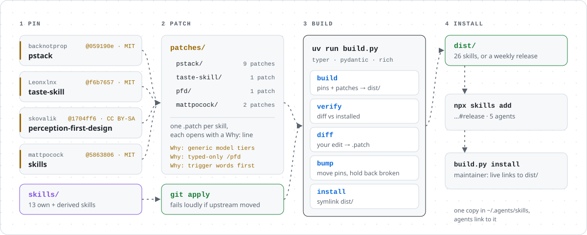
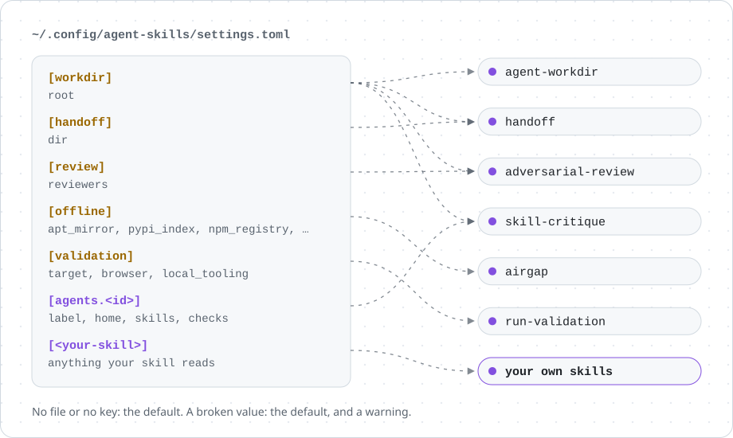

<picture>
  <source media="(prefers-color-scheme: dark)" srcset="docs/assets/hero-dark.svg">
  
</picture>

My skill set for coding agents. A skill is a folder with a `SKILL.md` that an agent loads when a task matches it, or when you type `/name`.

I use several coding agents every day, and their quality wasn't uniform. Part of the reason was the skills: each agent loaded a different set, and some skills were written for one vendor's models, with that vendor's model names and flags, which put the other agents off applying them. This repo gives every agent the same skills, written so any of them can follow them.

Three things set it apart:

- **Cross-agent.** One copy of every skill on disk and one global `AGENTS.md`, read by **<!-- agents:list -->Claude Code, Codex, Grok, Kimi Code and Pi<!-- /agents:list -->**, and installable into any other agent npx skills supports. Every agent works from the same directories, the same structure and the same rules.
- **Token-lean.** Every model-invocable skill puts its description into every session before you type a word. Building this set, I cut 174 skills: about 11k tokens of skill listings that loaded at every session start. Long skills I call by name are now typed-only, and the shared `AGENTS.md` went from 10–11.5k characters per CLI to under 8k. [`skill-critique`](skills/skill-critique/SKILL.md) measures this for your own setup and reviews every skill on the machine.
- **Opinionated.** It is built for me and tailored to how I work. Take what fits. Every change to someone else's skill is a small patch with a `Why:` line, or a fork with its own change notes where the change is the whole skill, so you can see each opinion and drop the ones you don't share.

## Contents

- [Quick start](#quick-start)
- [What's cooking](#whats-cooking)
- [How it works](#how-it-works)
- [The skills](#the-skills)
- [What I patched, and why](#what-i-patched-and-why)
- [Customize](#customize)
- [Write your own skill](#write-your-own-skill)
- [Recommended upstream packs](#recommended-upstream-packs-not-shipped-here)
- [AGENTS.md template](#agentsmd-template)
- [Licenses](#licenses)
- [Maintaining this repo](docs/maintaining.md): build commands, patches, releases, repo layout

## Quick start

### With npx skills

Requires Node.js 22.20 or newer. [npx skills](https://github.com/vercel-labs/skills) installs the latest release and asks which agents to link it into:

```sh
npx skills add mmgordon82/agent-skills#release -g --skill '*'
```

Keep `#release`. It is the built set; the default branch holds the sources, and installing it gets only my own skills.

Using the [recommended upstream packs](#recommended-upstream-packs-not-shipped-here) too? Install them first and this set last, so its patched versions replace theirs where names match.

### From a release archive

With the [GitHub CLI](https://cli.github.com/):

```sh
mkdir -p ~/.agents/skills
gh release download --repo mmgordon82/agent-skills -p '*.tar.gz' -O - | tar xz -C ~/.agents/skills
```

Or download the `.tar.gz` or `.zip` from the [releases page](https://github.com/mmgordon82/agent-skills/releases) and extract it there. Skills with the same name are replaced.

Codex, Kimi Code and Pi read `~/.agents/skills`. Claude Code reads `~/.claude/skills` and Grok `~/.grok/skills`, so link the skills into the dir of each one you use:

```sh
mkdir -p ~/.claude/skills && for s in ~/.agents/skills/*/; do ln -sfn "${s%/}" ~/.claude/skills/; done   # Claude Code
mkdir -p ~/.grok/skills && for s in ~/.agents/skills/*/; do ln -sfn "${s%/}" ~/.grok/skills/; done       # Grok
```

A real folder with the same name already there is left alone, and `ln` reports it.

### From source

Requires `git`, [uv](https://docs.astral.sh/uv/) and Node.js 22.20 or newer; uv installs Python 3.11+ and the script's dependencies on first run.

```sh
git clone https://github.com/mmgordon82/agent-skills && cd agent-skills
uv run build.py build                     # clone pins into .cache/, apply patches, write dist/
npx skills add ./dist -g --skill '*'      # once: copy into ~/.agents/skills, link the agents you pick
uv run build.py install --force           # point ~/.agents/skills/<skill> at dist/: rebuilds go live
```

`npx skills` handles agents: it detects them, links each skill into their skills dirs and keeps a lock file. `build.py install` only replaces the copies in `~/.agents/skills` with links into `dist/`, so `build.py build` updates every agent at once, and creates the settings file. Without `--force` it skips skills that already exist. Rerunning it is safe.

All `build.py` commands: [docs/maintaining.md](docs/maintaining.md#buildpy-commands).

## What's cooking

<picture>
  <source media="(prefers-color-scheme: dark)" srcset="docs/assets/pot-dark.svg">
  
</picture>

Most good skills come from someone else's repo, and using them as-is is rarely right:

- A pack hardcodes one vendor's model names.
- A skill runs `curl … | sudo sh`.
- A description is too long for Codex, which truncates it, so the skill never triggers.
- A rarely used skill costs hundreds of tokens in every session.

Copying and editing works once. After that your copy drifts from upstream, and nobody can tell what you changed. This repo keeps each upstream at a pinned commit and records every change as a `.patch` you can read in a minute. A weekly CI job moves the pins, re-applies the patches and publishes a release when the result changes. When an upstream change breaks a patch, CI rebuilds it from its `Why:` and opens a pull request to review.

| Approach | Updates from upstream | Your changes visible | Effort |
|---|---|---|---|
| Install upstream as-is | yes | no changes possible | none |
| Copy and edit (detach) | manual, lossy | buried in a copy | grows over time |
| **Pin + patch (this repo)** | weekly CI; broken patches rebuilt in a PR | one `.patch` per skill with a `Why:` line | none until a patch breaks |

## How it works

<picture>
  <source media="(prefers-color-scheme: dark)" srcset="docs/assets/pipeline-dark.svg">
  
</picture>

1. **Pin.** [`upstreams.toml`](upstreams.toml) lists each upstream repo, a full commit sha, its license, and which folders become which skills. `license_file` copies the upstream license into every skill shipped from it.
2. **Patch.** [`patches/<upstream>/<skill>.patch`](patches) is a plain `git diff` with a `Why:` line on top. Patches apply with `git apply`, and the build stops on the first one that fails.
3. **Build.** `build.py` checks out each pin, copies the mapped paths, applies the patches, adds [`skills/`](skills), and writes `dist/`. The old `dist/` is replaced only after a fully successful build.
4. **Install.** [npx skills](https://github.com/vercel-labs/skills) puts one copy of each skill in `~/.agents/skills` and links it into the skills dir of every agent you pick. When you build from source, `build.py install` points those copies at `dist/`, so each rebuild is live in every agent.

Building from source, releases and patch maintenance: [docs/maintaining.md](docs/maintaining.md).

## The skills

<picture>
  <source media="(prefers-color-scheme: dark)" srcset="docs/assets/skills-dark.svg">
  
</picture>

A `/` before a name means the skill is **typed-only**: it runs when you type `/name` and the model never loads it on its own. These are long skills you want on demand, and keeping them typed-only means their descriptions don't cost context in every session.

### Workflow

| Skill | Source | What it does |
|---|---|---|
| `/poteto-mode` | pstack + patch | An opinionated agent style: concise answers, deliberate subagents, simple code, verified work. Ships playbooks for features, bug fixes and multi-phase plans. |
| `delegate` | own | Multi-agent work without ceremony. Root plans and integrates; bounded explorer, worker, tester, researcher and reviewer subagents do the rest. |
| `/swarm` | pstack + patch | Fan out N parallel workers, drain them, return one report. |
| `/arena` | pstack + patch | N candidates on the same task; pick a base, graft the best parts of the losers into it. |
| `/architect` | pstack | Sketch types, signatures and module structure before code, then steer implementation. |
| `/reflect` | pstack | Reads the session transcript for lasting lessons and turns each into an edit on an existing skill. |
| `setup-pstack` | pstack + patch | Map pstack roles to *your* models through tiers (strong / fast / panel). |
| `adversarial-review` | own | Runs a different agent CLI (Claude, Codex, Grok, Kimi, Pi or any other) headless and read-only to attack your work: bugs, holes, unproven claims, cases you didn't expect. You verify each finding before acting. |

### Used by /poteto-mode

pstack skills that `/poteto-mode` and the other pstack skills call by name. All typed-only.

| Skill | Source | What it does |
|---|---|---|
| `/interrogate` | pstack | Adversarial multi-model review: adversaries try to break a change, and only findings proven by a run survive. |
| `/how` | pstack | How a subsystem works and where code should live: architecture, runtime flow, ownership. |
| `/why` | pstack | Why something is the way it is: decisions, tradeoffs, regressions, with citations. |
| `/figure-it-out` | pstack | An auditable playbook for work no narrower playbook fits: big migrations, multi-part changes. |
| `/show-me-your-work` | pstack | A decision log (what, why, evidence, result) for long or unattended runs. |
| `/ketchup` | pstack | Catches you up on what changed in the chat since your last message, and what waits on you. |
| `/benchmark-checklist` | pstack | Vets a performance measurement before you report or act on it. |
| `/tdd` | pstack | Test-first, only when asked or when the bug has a cheap local test. |
| `/create-verification-skill` | pstack | Generates a project skill that drives your app the way a user does. |
| `/create-formal-verification-skill` | pstack | Generates a project skill that formally verifies the riskiest code. |
| `/principle-*` | pstack | The engineering principles `/poteto-mode` applies by name: laziness protocol, fix root causes, prove it works and the rest. |

### Agent setup

| Skill | Source | What it does |
|---|---|---|
| `run-validation` | own | Picks where a claim gets tested: this machine, local Docker, or a VM matching the deploy target. Knows when CPU architecture matters (native code, binaries, images) and when it doesn't. Browser checks via chrome-devtools or Playwright MCP. |
| `agent-workdir` | own | Every report, probe, log, plan and screenshot goes to `<root>/<project>/<date>-<topic>/`, never into a checkout. `<root>` is [configurable](#customize), default `~/agent-work`. |
| `/handoff` | own | Writes a handoff so a fresh agent can continue from the same spot: goal and stated constraints, what was tried, what changed and why, current state, next steps. Saved to `<root>/<project>/handoffs/<YYYY-MM-DD>-<name>.md` ([configurable](#customize)). |
| `/skill-critique` | own | Reviews every skill on the machine: an overview by category with auto-load cost per agent, collisions, duplicates and near-duplicates; the per-session load of each agent (skills, plugins, hooks, instructions); then cuts, dedupes and one shared layout, applied after approval. Ships `scripts/skill_scan.py`. |

### Design & UI

| Skill | Source | What it does |
|---|---|---|
| `impeccable` | fork of pbakaus/impeccable | The lead UI workflow: build, critique, audit, polish. Adds `reference/usability.md`, about 55k characters of usability heuristics the skill reads before any UX judgment. |
| `/design-taste-frontend` | taste-skill + patch | Opinionated website builder for company, landing and product sites. Has its own finish gate. |
| `/pfd` | perception-first-design + patch | Perception-First Design analysis: analyze, evaluate, solve. |

### Ship & secure

| Skill | Source | What it does |
|---|---|---|
| `ship-audit` | fork of everything-claude-code | "Is this ready to ship?" A local-evidence audit with score caps (no auth, leaked secrets, unsafe migration, no rollback, untested restore) and a short ship/block answer. Includes checks for self-hosted services. |
| `security-hunt` | fork of everything-claude-code | Review your own code for remotely reachable bugs (SSRF, auth bypass, injection, RCE, path traversal, XSS). A finding counts only if input provably reaches a sink. |
| `web-perimeter-audit` | fork of everything-claude-code | Passive curl probes against a live domain: exposed `.git`, `.env` and lockfiles, CORS reflection, cache poisoning, HSTS/CSP, cookie flags. Includes nginx and Caddy hardening snippets, tested in Docker. |
| `db-migrations` | fork of everything-claude-code | Postgres-safe migrations: lock modes, `lock_timeout`, `CREATE INDEX CONCURRENTLY`, expand-contract, batched backfills, Django and golang-migrate. |
| `git-guardrails-claude-code` | mattpocock + patch | Claude Code hooks that block destructive git commands. The patch adds a hook that blocks `--no-verify` and edits to lint, format and pre-commit configs. |
| `docker-packaging` | own | Docker-first packaging: one small dockerizable app, existing pinned images over new Dockerfiles, Docker only where it validates something. |
| `airgap` | own | Only for targets you call offline. Build it: internal mirrors (optionally from [settings](#customize)), sensible version pins, no public fetches, vendored assets. Prove it: isolated runs (`--network none`, Linux netns), a network probe, a browser request audit, Playwright offline and native-error recipes, a public-host scan. |

### Writing

| Skill | Source | What it does |
|---|---|---|
| `unslop` | pstack + patch | Cuts AI tells from prose: docs, PRs, commits, UI copy. Ships `scripts/ste_lint.py`. |
| `technical-writing` | pstack + patch | READMEs, runbooks, RFCs, PR text: Diátaxis, Google style, Simplified Technical English, Global English. |
| `/no-comments` | pstack + patch | Sends the "Comment Sicko" reviewer after unnecessary comments. |
| `writing-for-agents` | mattpocock + patch | How to write skills, AGENTS.md and CLAUDE.md that agents follow. |

## What I patched, and why

Each line is the first line of the patch's `Why:` header. Below it, every header explains the problem, what the patch changes, what to keep when rebasing, and how to rebuild it on a new upstream version, so a broken patch can be rewritten from intent ([how](docs/maintaining.md#when-an-upstream-breaks-patches)).

| Patch | Why |
|---|---|
| [mattpocock/git-guardrails-claude-code](patches/mattpocock/git-guardrails-claude-code.patch) | Add block-weakened-checks.sh: block --no-verify and edits to lint, format and pre-commit configs. |
| [mattpocock/writing-for-agents](patches/mattpocock/writing-for-agents.patch) | A trigger-first description. |
| [pfd/pfd](patches/pfd/pfd.patch) | Typed-only /pfd, paths fixed for the flattened layout, version history cut, Codex typed-only. |
| [pstack/arena](patches/pstack/arena.patch) | Use the panel tier for runners and the judge pool, and model-agnostic fallbacks, instead of Cursor model ids. |
| [pstack/no-comments](patches/pstack/no-comments.patch) | Comments that survive are one line, two at most. |
| [pstack/poteto-mode](patches/pstack/poteto-mode.patch) | Define the model tiers (strong, fast, panel) in the Subagents section; playbooks use them instead of Cursor model ids. |
| [pstack/setup-pstack](patches/pstack/setup-pstack.patch) | Configure tiers (strong, fast, panel) mapped to the models a harness has, instead of writing Cursor model ids. |
| [pstack/swarm](patches/pstack/swarm.patch) | Use the fast tier for workers, and a model-agnostic fallback, instead of a Cursor model id. |
| [pstack/technical-writing](patches/pstack/technical-writing.patch) | Let the model invoke it, with a trigger-first description, and add four rules from the deleted STE and plain-writing skills. |
| [pstack/unslop](patches/pstack/unslop.patch) | Let the model invoke it, with a trigger-first description; add rules 34-41 and "How to apply" from three deleted anti-slop skills, plus an STE lint script. |
| [taste-skill/design-taste-frontend](patches/taste-skill/design-taste-frontend.patch) | Typed-only /design-taste-frontend with a one-line description, in Claude and in Codex. |

Upstream skills that are typed-only (`disable-model-invocation: true`) but ship no Codex policy get `agents/openai.yaml` from the build, so Codex treats them as typed-only too. That needs no patch.

Two upstreams became forks because their diffs would have been the whole skill:

- **impeccable** ([CHANGES.md](skills/impeccable/CHANGES.md)) is a trimmed fork. It adds `usability.md`, a no-fake-data rule, mobile viewport rules, and online-by-default assets.
- **everything-claude-code**: four skills rewritten for self-hosted Python/Go work, each with an `Adapted from … @3f14a10` line and the MIT license.

## Customize

<picture>
  <source media="(prefers-color-scheme: dark)" srcset="docs/assets/settings-dark.svg">
  
</picture>

Skills read one settings file, the same for every agent: `${XDG_CONFIG_HOME:-~/.config}/agent-skills/settings.toml`. `build.py install` creates it from [`settings.example.toml`](settings.example.toml) if it doesn't exist and never overwrites it. Installed another way (`npx skills`, a release archive)? Create it yourself:

```sh
mkdir -p "${XDG_CONFIG_HOME:-$HOME/.config}/agent-skills"
"${EDITOR:-nano}" "${XDG_CONFIG_HOME:-$HOME/.config}/agent-skills/settings.toml"
```

with this content, then change what you need:

```toml
# agent-skills settings: ${XDG_CONFIG_HOME:-~/.config}/agent-skills/settings.toml
# Every key is optional. A missing file or key means the default shown here.

[workdir]
# Where agents put reports, probes, logs, plans and handoffs: <root>/<project>/<YYYY-MM-DD>-<topic>/.
# Absolute or ~-prefixed. Never inside a repo checkout.
root = "~/agent-work"

[handoff]
# Folder for /handoff documents, relative to <root>/<project>/.
dir = "handoffs"

[review]
# adversarial-review picks the first installed CLI in this list that isn't the one running.
reviewers = ["codex", "grok", "claude", "kimi", "pi"]

[offline]
# Optional. Internal mirrors for the airgap skill, used only when you say a target is
# offline. Leave them empty if you don't need them: agents then work as they normally would.
apt_mirror = ""           # e.g. "https://artifactory.example.com/artifactory/debian-remote"
pypi_index = ""           # e.g. "https://artifactory.example.com/artifactory/api/pypi/pypi-remote/simple"
npm_registry = ""         # e.g. "https://artifactory.example.com/artifactory/api/npm/npm-remote/"
go_proxy = ""             # e.g. "https://artifactory.example.com/artifactory/api/go/go-remote"
container_registry = ""   # e.g. "artifactory.example.com/docker-remote"

[validation]
# The platform you usually deploy to: "linux/amd64" or "linux/arm64". A project's AGENTS.md overrides it.
# Architecture-dependent claims (native code, binaries, images) need an environment with this arch.
target = "linux/amd64"
# Browser-check tool: "chrome-devtools", "playwright", or "none".
browser = "chrome-devtools"
# Name of a private skill with machine-specific commands (VM CLI, MCP wrapper paths).
# run-validation reads it when it needs a VM. Leave as is if you don't have one.
local_tooling = "local-tooling"

# Coding agents, for /skill-critique and the docs. The shipped ones are in
# skills/skill-critique/agents.toml; add yours here, or override a shipped one field by field (same id).
# Required: label, home, skills. Optional: check_binary (programs on PATH), check_dir (more dirs that
# must exist), check_boolean_operator ("AND", the default: home and every check; "OR": any one).
#
# [agents.my-cli]
# label = "My CLI"
# home = "~/.my-cli"
# skills = "~/.agents/skills"
# check_binary = ["my-cli"]
```

| Key | Used by |
|---|---|
| `workdir.root` | `agent-workdir`, `handoff`, `adversarial-review`, `skill-critique`, and the AGENTS.md template |
| `handoff.dir` | `handoff` |
| `review.reviewers` | `adversarial-review` |
| `offline.*` | `airgap`, optional: used only when set and the target is offline |
| `agents.<id>` | Your own agents, or overrides of the ones in [`agents.toml`](skills/skill-critique/agents.toml), for `/skill-critique` |
| `validation.*` | `run-validation`: deploy target arch, browser tool, private VM-tooling skill |

- **No file, or a key missing:** the agent uses the default shown above without asking. A fresh install behaves exactly like the defaults.
- **Broken file or bad value** (invalid TOML, wrong type, a relative or in-repo `root`): the agent uses the default for that task and tells you which key to fix. It never writes output into the repo instead.
- **`root` missing on disk:** the agent creates it. If it can't, it stops and asks.

**Your own skills can use it too.** The file isn't reserved for this repo's skills. Give each of your skills its own section, named after the skill so keys never clash, and put private values there (hostnames, tool paths, account names) instead of in the skill. Skills here ignore sections they don't know, and `install` never overwrites the file. Add a section:

```toml
[my-skill]
api_base = "https://internal.example.com"
```

and paste this into your skill's `SKILL.md`:

```markdown
**Settings:** read `[my-skill]` from `${XDG_CONFIG_HOME:-$HOME/.config}/agent-skills/settings.toml`.
No file or no key → use the defaults below. A broken value → use the default and tell the user which key to fix.
```

## Write your own skill

A skill is a folder with a `SKILL.md`: frontmatter that says when to load it, then the instructions. Put it in `~/.agents/skills/<name>/` and link it into your other agents like any skill here.

Write the decisions the model wouldn't make by itself, not a tutorial; it already knows the language. Part of a skill for how I want Python written:

````markdown
---
name: python-style
description: "Use when writing or reviewing Python: functional core, pathlib, chosen libraries, measured speed."
---

# Python style

Defaults. Break one only for a reason you state in the change.

## Functional core, thin shell
- Logic lives in pure functions: data in, data out. I/O, env and the clock stay in `main()` and CLI handlers.
- Return new values instead of mutating arguments. Records are `@dataclass(frozen=True)`.
- A class needs state that changes. A bag of functions is a module.

## Files
- `pathlib.Path` end to end: `read_text()`, `write_text()`, `rglob()`. No `os.path` string joins.
- A write that must survive a crash goes to a temp file, then `tmp.replace(path)`.

## Libraries
| Need | Use |
|---|---|
| CLI | typer |
| HTTP | httpx |
| Parsing at boundaries | pydantic |
| Scripts | uv, with dependencies inline (PEP 723) |

## Fast, when it matters
- Measure first (`cProfile`, `python -X importtime`) and report the number before and after.
- Fix the data structure before the code: a set or dict lookup, not a scan of a list.
…
````

Every line is a stance you can disagree with, and that's the point. Private values (hosts, paths) go in the [settings file](#customize), not the skill.

To write one, ask your agent: it loads [`writing-for-agents`](#writing) for any skill, `AGENTS.md` or `CLAUDE.md` work. It covers triggers, what a skill costs per session, when to split, pruning, and how to make a skill load the same way in every agent. Then `/skill-critique` measures what your whole set costs and finds collisions.

## Recommended upstream packs (not shipped here)

Skills I use unmodified. Install them from their source so you get their updates. Install them first, in any order, and this set last ([Quick start](#quick-start)): its patched versions then replace pstack's where names match, and its `handoff` replaces mattpocock's.

- **[backnotprop/pstack](https://github.com/backnotprop/pstack)**: the pstack skills this set doesn't ship. Every skill `/poteto-mode` calls is already here.
  Examples: `statechart`, `teach`, `sharpen`, `recall`, `blast-radius`.

  ```sh
  npx skills add backnotprop/pstack -g --skill '*'
  ```

- **[emilkowalski/skills](https://github.com/emilkowalski/skills)**: animation and design-engineering skills.
  Examples: `animate`, `choreograph`, `gestures`, `review-animations`, `apple-design`, `mobile-native`.

  ```sh
  npx skills add emilkowalski/skills -g
  ```

- **[mattpocock/skills](https://github.com/mattpocock/skills)**: engineering workflow, plus typed-only long-form writing. Its `handoff` has the same name as this repo's.
  Examples: `codebase-design`, `diagnosing-bugs`, `domain-modeling`, `grilling`, `to-spec`, `wizard`, `writing-fragments`.

  ```sh
  npx skills add mattpocock/skills -g
  ```

- **[nextlevelbuilder/ui-ux-pro-max-skill](https://github.com/nextlevelbuilder/ui-ux-pro-max-skill)**: a local design research database that `impeccable` consults.
  Examples: `ui-ux-pro-max`.

  ```sh
  npx skills add nextlevelbuilder/ui-ux-pro-max-skill -g
  ```

- **[dzhng/jevgrep](https://github.com/dzhng/jevgrep)**: repo Q&A: answers "how does X work here" with ranked excerpts before grep.
  Examples: `jevgrep`.

  ```sh
  npx skills add dzhng/jevgrep -g
  ```

- **[obra/superpowers](https://github.com/obra/superpowers)**: workflow skills (I also run the full plugin in Claude Code).
  Examples: `brainstorming`.

  ```sh
  npx skills add obra/superpowers -g
  ```

- **[rea-agents](https://www.npmjs.com/package/rea-agents)**: reverse engineering: an MCP server and skill for binaries, apps, firmware and web bundles. It manages its own skill copy.
  Examples: `reverse-engineer-anything`.

  ```sh
  npm i -g rea-agents && rea setup
  ```

The skills CLI may write real copies into `~/.claude/skills`. To keep one source, move them to `~/.agents/skills` and symlink them back. `/skill-critique` finds these copies for you.

## AGENTS.md template

[`AGENTS.template.md`](AGENTS.template.md) is my global instruction file with personal details replaced by placeholders. It is short on purpose (about 7.5k characters; Grok's cap is 10k). Detailed procedures live in skills that the file points to by path:

| Section | Holds | Details in |
|---|---|---|
| How to talk to me | Answer first, less by default, labeled options, push back | — |
| Match effort | Small: just do it. Big: spec → approval → plan. | — |
| Engineering taste | Simplicity > maintainability > correctness > performance; parse at boundaries; rerunnable ops; behavior tests | — |
| Languages & dependencies | Python → Go → Bash → JS; use good libraries; uv + PEP 723 | — |
| Self-hosting | Online by default; offline only when stated | `docker-packaging`, `airgap` |
| Behavior I expect | Verify against the real output; test the assumption after two failed fixes; encode repeated corrections as checks | — |
| Where to run validation | Pick the first environment that has every property the claim depends on | `run-validation` |
| Agent work dir | Output never goes into a checkout | `agent-workdir` |
| Building sites, UIs & content | `impeccable` + `usability.md`; no unrequested copy; labs keep their difficulty | `impeccable` |

Use one file for every CLI. Download it, fill in the `<PLACEHOLDERS>`, then link it into each agent you use:

```sh
mkdir -p ~/.agents
test -e ~/.agents/AGENTS.md || curl -fsSL https://raw.githubusercontent.com/mmgordon82/agent-skills/main/AGENTS.template.md -o ~/.agents/AGENTS.md
ln -s ~/.agents/AGENTS.md ~/.claude/CLAUDE.md      # Claude Code
ln -s ~/.agents/AGENTS.md ~/.codex/AGENTS.md       # Codex
ln -s ~/.agents/AGENTS.md ~/.grok/AGENTS.md        # Grok
ln -s ~/.agents/AGENTS.md ~/.pi/agent/AGENTS.md    # Pi
```

None of these overwrite anything: `curl` is skipped if the file exists, and `ln -s` fails on an existing file. Merge your current instructions into `~/.agents/AGENTS.md` first, then move the old file away. Kimi Code reads `~/.agents/AGENTS.md` directly. Machine-specific commands (VM CLIs, MCP wrapper scripts) belong in a private `local-tooling` skill that you don't publish. `run-validation` reads it by path when it exists.

## Licenses

| Content | License |
|---|---|
| Own skills, `build.py`, `ci/`, `tools/`, `tests/`, docs, template, settings example | [MIT](LICENSE) |
| pstack, taste-skill and mattpocock skills, plus patches to them | MIT; each built skill carries its upstream `LICENSE` |
| `pfd` and its patch | CC BY-SA 4.0 (share-alike applies to the adaptation) |
| `impeccable` | Apache-2.0: `LICENSE`, `NOTICE.md` and `CHANGES.md` in the skill |
| `ship-audit`, `security-hunt`, `web-perimeter-audit`, `db-migrations` | MIT, adapted from affaan-m/everything-claude-code @3f14a10 |
