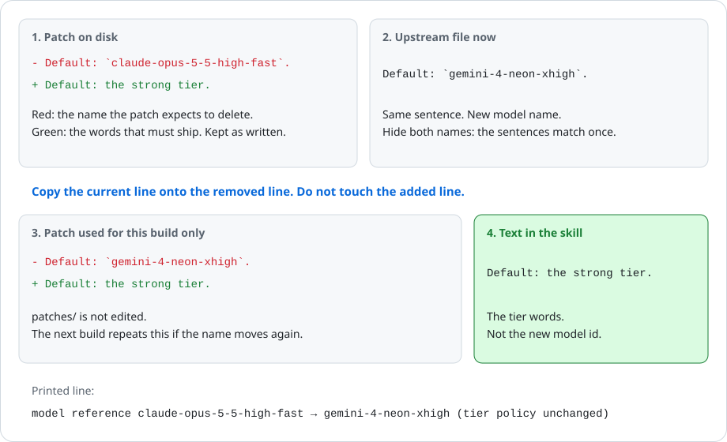
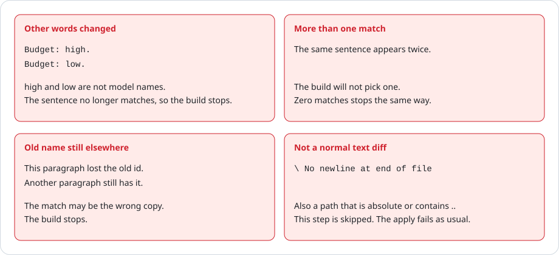

# How a tiered patch follows a renamed model

This page explains one behavior of `build.py`. An upstream with `tiered = true` in `upstreams.toml` may rename a model. The build still applies your patch, and the skill still says the tier words you wrote. Today only pstack sets the field. The upstream's name does not turn it on.

Commands and the weekly repair job are in [Maintaining agent-skills](maintaining.md).

## The exact patch is tried first

`git apply` runs on the patch file as committed. When that works, the build stops. No line is rewritten.

When apply fails, and the upstream has `tiered = true`, the build continues on a copy of the patch in memory. The file under `patches/` stays as committed. The next build repeats the same steps if the name has moved again.

## Which spellings count as a model name

The build treats three spellings as a model name. Anything else is ordinary text and must match exactly.

| Spelling | Examples |
|---|---|
| `claude-`, `gemini-`, `gpt-`, `grok-`, or `kimi-`, then a hyphen and a token that contains a digit | `claude-opus-5-5-high-fast`, `gemini-4-neon-xhigh`, `gpt-6.2-medium`, `grok-5-low` |
| A token that ends in `-high-fast`, `-xhigh-fast`, `-medium-fast`, or `-low-fast` | `claude-opus-5-5-xhigh-fast` |
| `Claude`, `Opus`, `Sonnet`, `Haiku`, `Fable`, `Gemini`, `GPT`, `Grok`, or `Kimi`, then a version number | `Opus 5.5`, `Fable 5.2`, `Gemini 5` |

These do not count, so a change to them blocks the patch:

- `Claude Code`. There is no version number.
- `auto` and `inherit-parent`.
- A bare `high` or `low`, as in `Budget: low`.
- The tier words on a line the patch adds, such as `the strong tier`.

A model id may change its effort suffix and still match. `claude-opus-5-5-high-fast` and `claude-opus-5-5-xhigh-fast` are both model names. The words around them are what must stay put.

## What is replaced, and with what

The target is a model name on a line the patch deletes, or on a context line the patch keeps. In the diff those lines start with `-` or with a space.

The replacement is the model name now in that same spot in the upstream file. The build checks that by hiding every model name and comparing the rest of the line. The hidden lines must match in exactly one place. The build then copies each current line over the patch's old line.

A line the patch adds starts with `+`. That line is not a target. It stays byte for byte. The skill gets those words, not the upstream's new model id.

<picture>
  <source media="(prefers-color-scheme: dark)" srcset="assets/model-names-dark.svg">
  
</picture>

Read the figure from 1 to 4.

1. The saved patch expects to delete `` `claude-opus-5-5-high-fast` `` and to add `the strong tier`.
2. Upstream has edited that sentence. It now says `` `gemini-4-neon-xhigh` ``. With the model names hidden, both sentences are `Default: `…`.`. That shape occurs once in the file.
3. The build copies the current sentence onto the removed line. The added line is still `the strong tier`. This copy exists only for the apply. `patches/` is not written.
4. The built skill contains `the strong tier`.

The build prints one line per pair that changed:

```text
poteto-mode.patch: model reference claude-opus-5-5-high-fast → gemini-4-neon-xhigh (tier policy unchanged)
```

The arrow is the upstream name moving. It is not the tier words changing. The real pstack patches do the same thing at larger size. `patches/pstack/poteto-mode.patch` removes `` `claude-opus-5-5-xhigh-fast` `` and adds `the strong tier`.

When one line has several model names, the build pairs each name with the name in that position on the current line. A line that gains or loses a model name does not match, and the build stops.

## When the build refuses

If this step cannot prove the edit is only a renamed model, it drops the copy. You see the original apply error. Repair that patch by hand, or let `ci/fix_patches.py` rebuild it from its `Why:` header.

<picture>
  <source media="(prefers-color-scheme: dark)" srcset="assets/model-names-refuse-dark.svg">
  
</picture>

- Other words changed. `Budget: high` became `Budget: low`. A new model name beside the old one counts as a different sentence too.
- The hidden sentence matches two places, or it matches none.
- The matched paragraph no longer contains the old model name. That old name still appears somewhere else in the file. The build will not assume it found the right paragraph.
- The diff is one this step does not read. That is a `\ No newline at end of file` marker, a path that is absolute, or a path that contains `..`.
